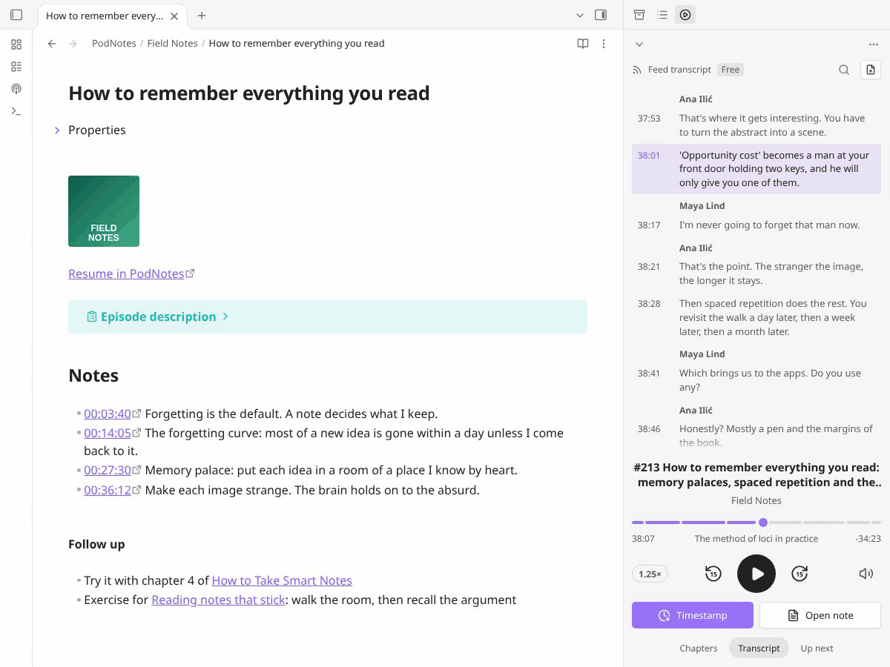

<h1 align="center">PodNotes</h1>

  <b>Take notes on podcasts without leaving Obsidian.</b> 
  Listen beside your notes, capture timestamps that link back to the moment, and get a note for every episode.

  <a href="https://obsidian.md/plugins?id=podnotes">Install</a>&nbsp;·
  <a href="https://podnotes.obsidian.guide">Documentation</a>&nbsp;·
  <a href="https://podnotes.obsidian.guide/getting-started/">Getting started</a>&nbsp;·
  <a href="https://github.com/chhoumann/PodNotes/releases">Release notes</a>

  <a href="https://podnotes.obsidian.guide">
    <picture>
      <source media="(prefers-color-scheme: dark)" srcset="docs/public/screenshots/demo-dark.gif">
      
    </picture>
  </a>

## What you can do

- **Listen beside your notes.** Search Apple Podcasts or paste any RSS feed, then play audio and video with speed control, a queue, and playlists.
- **Capture the moment.** One command inserts a timestamp link, such as `00:12:41`, into your note. Select it later to play from that second.
- **Get a note for every episode.** A template fills in the show, date, description, and a link that resumes playback. Browse the notes with Bases.
- **Take it with you.** PodNotes works on iOS and Android. Download episodes for offline listening, or play your own audio and video files.
- **Transcribe episodes** with your own OpenAI or Deepgram API key, with optional speaker labels.
- **Build your own workflows** with the commands, the JavaScript API, and QuickAdd.

## Get started

1. **Install PodNotes.** In Obsidian, open **Settings → Community plugins**, select **Browse**, search for **PodNotes**, then select **Install** and **Enable**.
2. **Add a podcast.** In **Settings → PodNotes**, search for a show or paste its RSS feed URL, then select **Add**.
3. **Capture a moment.** Run **PodNotes: Show player** and play an episode. In a note, run **PodNotes: Capture Timestamp**.

[Getting started](https://podnotes.obsidian.guide/getting-started/) walks through each step.

## Learn more

- [Use PodNotes on your phone](https://podnotes.obsidian.guide/mobile/)
- [Capture timestamps](https://podnotes.obsidian.guide/timestamps/)
- [Create episode notes](https://podnotes.obsidian.guide/notes/)
- [Sync between devices](https://podnotes.obsidian.guide/sync/)
- [FAQ](https://podnotes.obsidian.guide/faq/)

## Help and contributing

To report a bug or suggest an idea, [open an issue](https://github.com/chhoumann/PodNotes/issues). To work on PodNotes itself, read [CONTRIBUTING.md](CONTRIBUTING.md).

PodNotes is free and open source under the [MIT license](LICENSE). If it helps you, you can [support its development](https://www.buymeacoffee.com/chhoumann).
